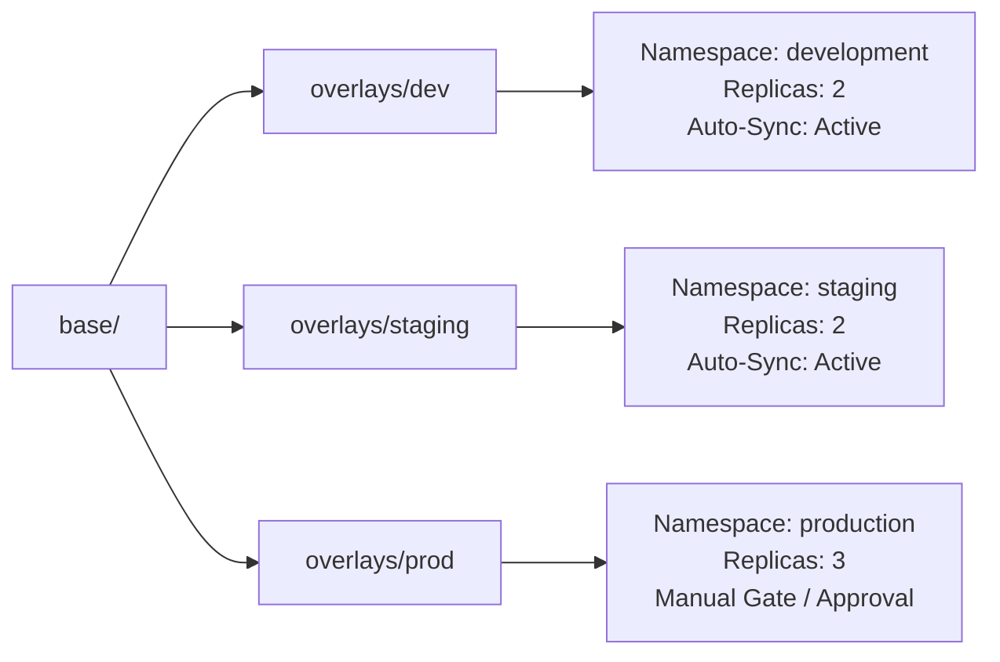

# Secure GitOps Continuous Delivery Platform (DevSecOps)

Declarative multi-environment Kubernetes deployment platform managed through **Kustomize** and **ArgoCD**, implementing automated GitOps synchronization, zero-downtime rolling updates, and workload self-healing.

---

## 1. Architecture Overview

```
Developer Push / PR
       ↓
GitHub Actions CI (Gitleaks, Hadolint, Trivy, pip-audit)
       ↓ (Build & push image with commit SHA to GHCR)
Update Image Tag in GitOps Config Repo (overlays/dev)
       ↓
ArgoCD (GitOps Controller)
  ├── Detects Git commit in this repo
  ├── Compares Desired State (Git) vs Live State (Cluster)
  ├── Automated Sync & Drift Reconciliation (selfHeal: true)
  └── Deploys to Kubernetes Cluster across Environments
```

---

## 2. Repository Structure

```
gitops-config/
├── base/
│   ├── deployment.yaml      # Workload specification with Layer-1 resilience
│   ├── service.yaml         # Internal ClusterIP service with named ports
│   ├── hpa.yaml             # HorizontalPodAutoscaler v2 (CPU 60% + Mem 70%)
│   ├── pdb.yaml             # PodDisruptionBudget (minAvailable: 1)
│   └── kustomization.yaml   # Base manifest bundler
├── overlays/
│   ├── dev/                 # Dev environment overlay (auto-sync)
│   │   └── kustomization.yaml
│   ├── staging/             # Staging environment overlay
│   │   └── kustomization.yaml
│   └── prod/                # Production overlay (gated sync, 3 replicas)
│       └── kustomization.yaml
├── argocd-app.yaml          # ArgoCD Application manifests (dev/staging/prod)
└── README.md
```

---

## 3. Workload Resilience & Production Standards (Layer 1)

Every workload deployed through this repository enforces strict high-availability and zero-downtime controls:

| Feature | Configuration | Purpose / Failure Prevented |
| :--- | :--- | :--- |
| **Zero-Downtime Rollouts** | `maxUnavailable: 0`<br>`maxSurge: 1` | Prevents removing older pods until replacement pods are verified healthy and ready. |
| **Startup Buffering** | `startupProbe` (10 × 3s = 30s budget) | Prevents premature container kill loops while database connections and caches warm up. |
| **Ingress Isolation** | `readinessProbe` (5s interval, 2s timeout) | Immediately stops routing ingress traffic away from degrading pods before 500 errors occur. |
| **Deadlock Restart** | `livenessProbe` (10s interval, 2s timeout) | Restarts containers that experience unrecoverable thread deadlocks or internal failures. |
| **Node Drain Protection** | `PodDisruptionBudget` (`minAvailable: 1`) | Guarantees cluster maintenance, node drains, or upgrades never take down all replicas at once. |
| **Horizontal Autoscaling** | `autoscaling/v2` (CPU 60%, Mem 70%) | Scales dynamically between 2 and 5 pods with a 5-minute stabilization window to avoid flapping. |
| **Graceful Shutdown** | `terminationGracePeriodSeconds: 60` | Allows in-flight HTTP transactions to cleanly complete before pod termination. |
| **Least-Privilege Security** | `runAsNonRoot: true`, `runAsUser: 1000`<br>`readOnlyRootFilesystem: true` | Hardens container against privilege escalation and malicious filesystem modifications. |

---

## 4. Multi-Environment Strategy



- **`development`**: Tracks latest commits automatically from CI with prefix `dev-`.
- **`staging`**: Mirrors production settings for pre-release validation.
- **`production`**: Patched with 3 baseline replicas, strict manual sync triggers in ArgoCD, and isolated secrets.

---

## 5. ArgoCD GitOps Workflow & Drift Self-Healing

ArgoCD continuously monitors this repository and reconciles the cluster:

```bash
# Register all environments in ArgoCD
kubectl apply -f argocd-app.yaml

# Check ArgoCD application synchronization status
argocd app list
argocd app get platform-dev
```

### Self-Healing & Drift Demonstration
If an engineer attempts a manual cluster mutation (e.g. `kubectl -n development scale deploy/dev-platform-app --replicas=10`), ArgoCD detects the live state deviating from Git and **automatically reconciles it back** to the declared Git state within seconds.

### Instant Rollback via Git
Because Git is the single source of truth, rolling back a deployment requires no imperative cluster commands:
```bash
git revert HEAD
git push origin main
```
ArgoCD detects the revert commit and automatically transitions the cluster to the previous healthy revision.

---

## 6. Local Validation & Testing

```bash
# Verify base manifests
kubectl kustomize base/

# Verify environment overlay compilation
kubectl kustomize overlays/dev/
kubectl kustomize overlays/staging/
kubectl kustomize overlays/prod/

# Test direct cluster apply (non-ArgoCD test environments)
kubectl apply -k overlays/dev/
kubectl -n development rollout status deploy/dev-platform-app
```
